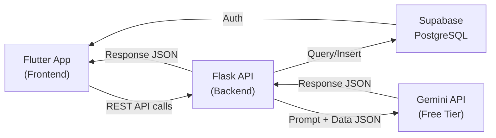

# **Product Requirement Document (PRD): GERDHero**

**Nama Produk:** GERDHero

**Penulis (Author):** Tim GERDHero

**Status:** Draft

**Tanggal:** 14 Oktober 2026

**Versi:** v1.0 (MVP — Hackathon 4 Hari)

---

## **01. Background & Context**

### **Problem Statement**

- **Masalah Utama:** Penderita GERD (Gastroesophageal Reflux Disease) di Indonesia kesulitan memantau gejala harian, mengidentifikasi pemicu kambuh, dan menyampaikan riwayat gejala secara terstruktur kepada dokter. Saat ini, pencatatan gejala dilakukan secara manual, tidak konsisten, dan sering terlupakan — sehingga dokter tidak memiliki data longitudinal yang memadai untuk membuat keputusan klinis yang optimal.

- **Data Pendukung:**

   - _Kuantitatif:_ Prevalensi GERD di Asia Tenggara berkisar 5–10% populasi dan terus meningkat seiring perubahan gaya hidup. Di Indonesia, data Kalbemed menunjukkan kuesioner GERD-Q adalah instrumen skrining tervalidasi dengan sensitivitas 65% dan spesifisitas 71% pada skor ≥8.

   - _Kualitatif:_ Banyak penderita GERD mengeluhkan kesulitan mengingat pola makan, waktu tidur, dan gejala yang dialami saat konsultasi ke dokter. Catatan manual (buku harian kertas/notes) tidak terstruktur dan jarang dikerjakan konsisten.

- **Masalah Sekunder:**

   - Penderita tidak menyadari korelasi antara kebiasaan makan (pedas, berlemak, berkafein) dengan kekambuhan gejala.
   - Jeda makan malam ke tidur yang terlalu pendek (<2–3 jam) sering tidak disadari sebagai faktor pemicu refluks nokturnal.
   - Dokter menerima laporan subjektif tanpa data kuantitatif saat konsultasi, menyulitkan evaluasi progres pengobatan.
   - Penderita tidak memiliki sistem peringatan dini ketika gejala menunjukkan tren memburuk.

### **Market Opportunity**

- **Tren Pasar:** Pasar aplikasi kesehatan digital (*digital health apps*) global diproyeksikan tumbuh pesat, dengan segmen *chronic disease management* menjadi salah satu pendorong utama. Kesadaran masyarakat Indonesia terhadap GERD meningkat signifikan, didorong oleh edukasi media sosial dan konten kesehatan daring.

- **Proyeksi & Statistik:** Dengan populasi Indonesia >275 juta dan prevalensi GERD 5–10%, potensi pengguna berkisar 14–27 juta orang. Belum ada aplikasi pemantauan GERD berbahasa Indonesia yang menyediakan pelacakan gejala harian, analisis pemicu berbasis AI, dan laporan klinis terstruktur.

- **Lanskap Kompetitor & Diferensiasi:**

   | Kompetitor | Kelemahan | Diferensiasi GERDHero |
   |---|---|---|
   | GERD Tracker (EN) | Hanya tersedia dalam bahasa Inggris, fitur terbatas | Full Bahasa Indonesia, analisis AI, laporan PDF klinis |
   | mySymptoms | Generik (semua penyakit GI), tidak spesifik GERD | Fokus khusus GERD dengan bobot gejala Certainty Factor |
   | Catatan manual/kertas | Tidak terstruktur, sulit dianalisis | Otomatis, terstruktur, visualisasi tren, ekspor PDF |

### **User Personas**

| **Persona** | **Profil & Karakteristik** | **Kebutuhan & Tantangan** | **Solusi Saat Ini** | **Solusi GERDHero** |
|---|---|---|---|---|
| **Penderita GERD Aktif** | Usia 20–45 tahun, pekerja kantoran, sering konsumsi makanan pedas/berkafein, pola makan tidak teratur, rentan stres tinggi | Butuh cara mudah mencatat gejala harian, memahami pemicu kambuh, dan menyampaikan data ke dokter | Mencatat di notes HP atau tidak mencatat sama sekali; mengandalkan ingatan saat konsultasi | Log harian 3 langkah, analisis AI pemicu, ringkasan otomatis, laporan PDF klinis siap cetak |
| **Penderita GERD Baru** | Usia 18–35 tahun, baru mengalami gejala refluks, belum tahu apakah menderita GERD, kecemasan tinggi | Butuh skrining awal, edukasi tentang GERD, dan pemantauan gejala untuk bahan konsultasi pertama ke dokter | Googling gejala, panik, atau mengabaikan gejala | Kuesioner GERD-Q tervalidasi, maskot Gerdie yang menenangkan, perhatian klinis tanpa menambah kecemasan |

### **Vision Statement**

- **Visi Produk:** GERDHero menjadi pendamping harian terpercaya bagi penderita GERD di Indonesia — membantu pengguna memantau gejala, mengenali pemicu, dan menjaga kesehatan lambung secara mandiri melalui teknologi AI, sambil menyediakan laporan klinis terstruktur yang menjembatani komunikasi pasien-dokter.

- **Alignment Tim:** Produk ini dikembangkan dalam konteks hackathon 4 hari sebagai MVP fungsional yang siap demo, dengan potensi pengembangan lebih lanjut menjadi produk *health-tech* yang layak pasar.

- **Sinergi Industri:** Sejalan dengan arah digitalisasi layanan kesehatan di Indonesia dan mendukung paradigma *patient empowerment* — di mana pasien berperan aktif dalam pemantauan kondisi kesehatannya sendiri.

### **Product Origin**

- **Asal-Usul Ide:** Ide lahir dari pengalaman pribadi anggota tim dan observasi terhadap sulitnya penderita GERD mengelola kondisi kronis mereka tanpa alat bantu yang memadai. Banyak penderita baru sadar korelasi gejala-pemicu setelah bertahun-tahun.

- **Momentum Penting:** Peningkatan tren pencarian "GERD", "asam lambung naik", dan "obat maag" di Indonesia menjadi validasi kebutuhan yang nyata. Instrumen GERD-Q dari Kalbemed memberikan landasan medis terstandar yang bisa diadaptasi ke dalam aplikasi.

- **Umpan Balik Awal & Pilot Study:** Diskusi informal dengan beberapa penderita GERD mengonfirmasi bahwa mereka menginginkan: (1) cara cepat mencatat gejala, (2) pemahaman tentang apa yang memicu kambuh, dan (3) "bukti" data untuk dibawa ke dokter.

---

## **02. Objectives & Success Metrics**

### **SMART Goals**

- **Specific:** Mengembangkan MVP aplikasi GERDHero yang fungsional dan siap demo dalam waktu 4 hari hackathon, mencakup seluruh fitur ber-status "Must" pada pemetaan fitur.

- **Measurable:** Seluruh 6 modul utama (Onboarding, Home, Log Harian, Logika AI, Analytik, Report) berfungsi *end-to-end* tanpa *critical bug* saat demo.

- **Achievable:** Tim 4 orang dengan kemampuan low-mid dapat menyelesaikan MVP dengan pembagian kerja paralel (2 frontend, 1 backend+API, 1 integrasi AI+logika).

- **Relevant:** MVP yang berfungsi membuktikan konsep bahwa pemantauan GERD berbasis AI dapat membantu penderita mengenali pola gejala dan pemicu secara mandiri.

- **Time-bound:** Seluruh fitur MVP selesai dan siap demo pada hari ke-4 hackathon (18 Oktober 2026).

### **Key Performance Indicators (KPIs)**

| **KPI** | **Benchmark Saat Ini** | **Target** | **Alat & Metode Pengukuran** |
|---|---|---|---|
| **Fitur Must Selesai** | 0% | 100% (seluruh fitur Must) | Checklist manual & demo |
| **Alur End-to-End Berfungsi** | N/A | Onboarding → Log → Analytik → Report tanpa error | Testing manual |
| **Waktu Isi Log Harian** | N/A | < 3 menit per sesi | Uji coba internal tim |
| **Ekspor PDF Berhasil** | N/A | PDF 2 halaman tergenerate dengan data benar | Testing manual |

### **Qualitative Objectives**

- **Target Kualitatif:** Pengguna merasa nyaman dan tidak cemas saat menggunakan aplikasi berkat nada bahasa yang empatik, maskot Gerdie yang suportif, dan disclaimer medis yang jelas.

- **Pengumpulan Umpan Balik:** Demo langsung kepada juri hackathon dan audiens; pengumpulan feedback verbal.

- **Pengolahan Insights:** Masukan dari juri dan audiens akan dicatat untuk iterasi pasca-hackathon.

### **Strategic Alignment**

- **Keselarasan Hackathon:** Produk mendemonstrasikan penerapan AI (Gemini API) pada domain kesehatan, menunjukkan kemampuan teknis tim, dan menjawab *problem statement* yang relevan secara sosial.

- **Sinergi Proyek:** Integrasi kuesioner GERD-Q terstandar memberikan kredibilitas medis; penggunaan Gemini API menunjukkan pemanfaatan teknologi AI terkini.

### **Risk Mitigation**

| **Potensi Risiko / Tantangan** | **Tingkat Risiko (H/M/L)** | **Strategi Mitigasi** | **Rencana Kontinjensi** |
|---|---|---|---|
| **Keterbatasan waktu 4 hari** | High | Fokus eksklusif pada fitur Must; fitur Should hanya dikerjakan jika Must sudah aman | Pangkas fitur Should yang belum selesai, prioritaskan alur demo end-to-end |
| **Gemini API Free Tier rate limit / downtime** | High | Implementasi fallback template (D7) untuk semua output AI; cache respons AI | Gunakan respons template statis saat demo jika API tidak responsif |
| **Kemampuan tim low-mid** | Medium | Gunakan boilerplate/template Flutter dan Flask; hindari arsitektur kompleks | Sederhanakan UI, kurangi animasi, fokus pada fungsionalitas |
| **Integrasi frontend-backend gagal** | Medium | Definisikan kontrak API (endpoint, request/response format) di hari pertama | Gunakan data mock/hardcoded di frontend untuk demo |
| **Bug kritis saat demo** | Medium | Sisihkan setengah hari terakhir untuk testing & bug fixing | Siapkan alur demo yang sudah diuji berulang kali; hindari fitur yang belum stabil |

---

## **03. Features & Scope**

### **Core Features**

1. **Onboarding & Autentikasi (A1–A7):** Alur sambutan dengan maskot Gerdie, layar disclaimer wajib centang, autentikasi manual (email + kata sandi) dan OAuth Google, pengisian profil dasar (nama, tanggal lahir, jenis kelamin, tinggi/berat badan dengan kalkulasi BMI otomatis), serta kuesioner GERD-Q awal dengan halaman hasil (skor 0–7: kemungkinan tidak GERD, skor 8–18: kemungkinan GERD).

2. **Home / Beranda (B1–B4):** Tampilan utama dengan sapaan, tombol "Isi Log Harian", kartu skor GERD-Q terakhir beserta status evaluasi berkala, riwayat level GERD 7 hari dalam format bar chart mingguan, dan tombol "Lihat riwayat lengkap" yang membuka halaman riwayat per hari per minggu (dengan detail harian).

3. **Log Harian — Sesi 3 Slide (C1–C5, C7):**
   - **Slide 1 — Gejala:** 9 gejala yang bisa dicentang (Heartburn, Regurgitasi, Nyeri dada, Kesulitan menelan, Kembung & gas, Suara serak, Keringat dingin, Kram perut, Ketidaknyamanan tenggorokan), opsi "Tidak ada gejala", dan deskripsi opsional (maks. 250 karakter).
   - **Slide 2 — Pemicu & Kebiasaan:** 5 pertanyaan ya/tidak (pedas, berlemak/gorengan, asam, berkafein, bersoda), frekuensi makan, jam makan per waktu makan (dengan konfirmasi sekali ketuk "sama persis" jika frekuensi sama dengan kemarin ±1 jam), tingkat stres (1–5 dengan emoji), jam tidur & bangun (durasi tidur otomatis), dan konsumsi obat (ya/tidak, jenis obat, frekuensi).
   - **Slide 3 — Ringkasan Hari Ini:** Level GERD (indeks persentase), perbandingan dengan hari kemarin, pemicu berpotensi terkait (analisis AI dengan label "Dianalisis AI"), kebiasaan yang mendukung gejala, data diri pendukung (usia, BMI), dan **kalimat tetap keselamatan** ("Gejala seperti nyeri dada atau sesak napas dapat berkaitan dengan kondisi lain...").

4. **Logika & AI (D1–D7):**
   - **Level GERD Harian (D1):** Dihitung dari penjumlahan bobot gejala menggunakan metode *Certainty Factor*. Bobot: Heartburn 0.6, Regurgitasi 0.7, Nyeri dada 0.8, Sulit menelan 0.6, Kembung & gas 0.4, Suara serak 0.2, Keringat dingin 0.4, Kram perut 0.3, Ketidaknyamanan tenggorokan 0.4.
   - **Konsistensi frekuensi makan (D2):** Perbandingan hari ini vs kemarin (0/1). Hari pertama = "belum tersedia".
   - **Konsistensi jam makan (D3):** Toleransi ±60 menit per makan ke-k.
   - **Jeda makan-tidur (D4):** Makan terakhir kemarin ke jam tidur semalam, patokan 2–3 jam.
   - **Flag iritan (D5):** Jawaban "ya" = iritan aktif (1).
   - **Penalaran AI (D6):** Gemini API menerima input data terstruktur, mengembalikan JSON (pemicu, ringkasan, rekomendasi). Bahasa "berpotensi berkaitan", tanpa diagnosis, tanpa jaminan aman.
   - **Fallback template (D7):** Respons template statis jika AI gagal + loading state. **Wajib untuk demo.**

5. **Analytik (E1–E5):**
   - Filter mingguan/bulanan dengan grafik tren level GERD (line chart).
   - Pemicu teratas (bar chart frekuensi pemicu pada hari bergejala).
   - Ringkasan periode oleh AI.
   - Faktor yang menaikkan dan menurunkan level GERD (dengan persentase pengaruh).
   - Rekomendasi kebiasaan berbasis bukti klinis.

6. **Report / Laporan Klinis (F1–F2):**
   - Input periode laporan (7 hari, 30 hari, kustom) dengan info isi laporan.
   - Pratinjau laporan format medical report A4 (2 halaman inti). Bagian meliputi: A. Identitas Pengguna, B. Ringkasan Pemantauan, C. Riwayat Gejala, D. Skor GERD-Q, E. Pemicu yang Dilaporkan, F. Pola Hidup, G. Riwayat & Kebiasaan Harian, H. Obat & Suplemen.
   - Ekspor PDF (2 halaman, footer di tiap halaman, nomor laporan otomatis).

### **User Benefits & Use Cases**

- **Manfaat Pengguna:**
   - Mencatat gejala harian dalam < 3 menit melalui 3 slide terstruktur.
   - Memahami korelasi antara makanan, kebiasaan, dan gejala GERD melalui analisis AI.
   - Memiliki laporan klinis terstruktur siap cetak untuk konsultasi dokter.
   - Mendapat skrining awal GERD melalui kuesioner GERD-Q terstandar.

- **Skenario Penggunaan (Use Cases):**
   - _Skenario A:_ Budi (28 tahun) baru mengunduh GERDHero → menyelesaikan onboarding → mengisi profil dasar → mengerjakan kuesioner GERD-Q → mendapat skor 11 (kemungkinan GERD) → mulai mengisi log harian → setelah 7 hari melihat bahwa kafein dan makan pedas muncul di 5 dari 7 hari bergejala → membawa laporan PDF ke dokter.
   - _Skenario B:_ Sari (35 tahun) sudah menggunakan GERDHero 2 minggu → membuka tab Analytik → melihat tren gejala menurun setelah mengurangi konsumsi kopi → ringkasan AI mengonfirmasi korelasi → merasa termotivasi melanjutkan perubahan kebiasaan.

### **Technical Specifications**

- **Persyaratan Teknis:** Aplikasi mobile cross-platform (Android & iOS) dengan Flutter; backend REST API dengan Python Flask; database PostgreSQL melalui Supabase; integrasi Gemini API Free Tier untuk analisis AI.

- **Dependensi & Integrasi:** Supabase Auth (autentikasi email + OAuth Google), Supabase Storage (jika diperlukan), Gemini API (analisis pemicu, ringkasan, rekomendasi).

- **Skalabilitas & Performa:** MVP dirancang untuk skala demo (1–10 pengguna simultan). Arsitektur memungkinkan *horizontal scaling* di masa depan.

### **Feature Prioritization (MoSCoW)**

- **Must Have (Wajib Ada — MVP):**
   - A1: Splash dan sambutan (maskot Gerdie)
   - A2: Disclaimer wajib centang
   - A3: Autentikasi manual (Masuk/Daftar: email, kata sandi, konfirmasi)
   - A4: OAuth Google
   - A6: Profil dasar (tanggal lahir/usia, jenis kelamin, tinggi/berat/BMI)
   - A7: Kuesioner GERD-Q awal dan halaman hasil
   - B1: Tombol Log Harian
   - B2: Kartu Skor GERD-Q terakhir
   - B3: Riwayat level GERD 7 hari + tombol "Lihat riwayat lengkap"
   - B4: Riwayat Lengkap (kartu harian per minggu) dan Detail Harian
   - C1: Slide 1 — 9 gejala, opsi "Tidak ada gejala", deskripsi opsional
   - C2: Slide 2 — 5 pertanyaan ya/tidak pemicu makanan/minuman
   - C3: Slide 2 — Frekuensi makan, jam makan, konfirmasi sekali ketuk
   - C4: Slide 2 — Stres 1–5, jam tidur/bangun, konsumsi obat
   - C5: Slide 3 — Level GERD, pemicu AI, kebiasaan pendukung, data diri
   - C7: Kalimat tetap keselamatan di slide 3
   - D1: Level GERD harian (Certainty Factor)
   - D2: Konsistensi frekuensi makan
   - D3: Konsistensi jam makan
   - D4: Jeda makan-tidur
   - D5: Flag iritan makanan
   - D7: Fallback template + loading state bila AI gagal
   - E1: Filter mingguan/bulanan dan grafik tren level GERD
   - E2: Pemicu teratas
   - E3: Ringkasan periode (AI)
   - E4: Faktor penaikkan/penurunan level GERD
   - E5: Rekomendasi kebiasaan
   - F1: Input periode laporan, info laporan, pratinjau
   - F2: Ekspor PDF

- **Should Have (Sangat Penting — dikerjakan bila Must aman):**
   - A5: Lupa kata sandi (3 layar)
   - A8: GERD-Q berkala otomatis setiap 7 hari dengan notifikasi pengingat — memastikan pengguna mengevaluasi kondisi secara periodik
   - B5: Maskot Gerdie dengan 4 keadaan ekspresif (Tenang, Bergejala, Baru Mulai, Lama Tidak Log) berdasarkan kondisi kesehatan lambung pengguna + chip streak hari berturut-turut
   - B6: Profil lengkap: kebiasaan (merokok, alkohol, pola kerja, kopi), riwayat penyakit, obat rutin — memperkaya konteks analitik
   - B7: Sapaan nama di Home
   - C6: Draf tersimpan lokal
   - D6: Penalaran AI (pemicu, ringkasan, rekomendasi habit)
   - E6: Tingkat Perhatian Komplikasi — indikator pemantauan berbasis faktor persisten untuk deteksi dini risiko komplikasi
   - E7: Peringatan tren

- **Could Have (Opsional — pasca-hackathon):**
   - Notifikasi push pengingat log harian
   - Integrasi wearable (data tidur dari smartwatch)
   - Multi-bahasa (Inggris)
   - Mode gelap (*dark mode*)

- **Won't Have (Tidak Sekarang):**
   - Fitur konsultasi langsung dengan dokter
   - Marketplace obat/suplemen
   - Komunitas/forum antar pengguna
   - Gamifikasi berbasis *reward*

### **Future Enhancements**

- **Peta Jalan Visi Produk:** Evolusi dari alat pemantauan mandiri menjadi *companion app* untuk manajemen GERD komprehensif yang terintegrasi dengan ekosistem kesehatan digital.

- **Rencana Pasca-Hackathon (Prioritas Berikutnya):**
   - Notifikasi push untuk pengingat log harian (Could Have yang ditunda).
   - Integrasi wearable — sinkronisasi data tidur dari smartwatch/health platform.
   - Multi-bahasa (Inggris) untuk jangkauan pengguna yang lebih luas.
   - Mode gelap (*dark mode*) untuk kenyamanan pengguna malam.

- **Visi Jangka Panjang:**
   - Koneksi ke rekam medis elektronik (RME/EMR) untuk integrasi dengan ekosistem kesehatan digital.
   - Modul konsultasi telemedicine bersama dokter gastroenterologi.
   - Gamifikasi berbasis *reward* (badge, milestone, leaderboard).
   - Analitik populasi (agregat anonim) untuk riset GERD di Indonesia.

---

## **04. User Experience (UX) & Design**

### **User Interface (UI) Design**

- **Gaya Visual & Design System:**
   - **Design System:** GERDHero Design System — "Serene Clinical"
   - **Warna Primer:** Teal `#2BA89A` sebagai warna utama, mencerminkan ketenangan dan kepercayaan medis.
   - **Palet Gradasi:**
      - Tenang (Calm): Gradasi mint netral (`#ebfbf7` → `#d6f2ec`) & Teal `#2BA89A`
      - Bergejala (Symptomatic): Gradasi amber lembut (`#fef8ea` → `#fdecc4`)
      - Tidak Aktif: Gradasi abu-abu teduh netral (`#f8fafc` → `#e2e8f0`)
   - **Tipografi:** Font sans-serif modern, hierarki yang jelas (heading bold, body regular).
   - **Ikon:** Rounded, friendly, konsisten dengan nada non-klinis yang menenangkan.
   - **Prinsip Nada Bahasa:** Empatik, validatif, *non-judgmental*, *zero guilt*. Karakter Gerdie **tidak pernah** menghukum atau membuat pengguna merasa bersalah.

- **Komponen Utama UI:**
   - **Bottom Navigation:** 3 tab — Beranda, Analitik, Laporan.
   - **Maskot Gerdie:** Karakter tetesan air berkarakter — 4 keadaan ekspresi (Tenang/Calm, Bergejala/Symptomatic, Belum Ada Log, Lama Tidak Log).
   - **Hero Card Beranda:** Kartu utama di beranda yang menampilkan maskot Gerdie dengan pesan empatik sesuai kondisi pengguna.
   - **Chip Streak:** Indikator hari berturut-turut mengisi log, ditampilkan di pojok hero card.
   - **Kartu GERD-Q:** Menampilkan skor terakhir dengan visualisasi circular progress.
   - **Bar Chart 7 Hari:** Visualisasi level GERD mingguan di beranda.
   - **Form Log 3 Slide:** Navigasi horizontal dengan step indicator (1/3, 2/3, 3/3).
   - **Tombol CTA Utama:** Rounded full-width, warna Teal, teks putih.

- **Mockups & Wireframes:** Seluruh desain UI tersedia sebagai file PNG di folder project:
   - Onboarding: `A1.png` – `A7_A8-2.png`
   - Beranda: `B1_B2_B3_B5_B7.png` – `B6.png`
   - Log Harian: `C1.png` – `C5.png`
   - Analytik: `E1.png`
   - Report: `F1.png` – `F2.png`
   - Spesifikasi Maskot: `Html → Body.png`

### **User Journey**

- **Alur Pengguna Baru (Onboarding):**
   1. Splash screen dengan maskot Gerdie ("Hai, aku Gery! Teman Sehat Lambungmu") → ketuk "Mulai"
   2. Layar Disclaimer "Sebelum Mulai" — 3 poin info (Protokol Pemantauan Mandiri, Bukan Pengganti Dokter, Data Pribadi Anda) → centang "Saya memahami dan menyetujui" → "Lanjutkan"
   3. Autentikasi: Tab Masuk / Daftar — email + kata sandi (atau "Lanjutkan dengan Google")
   4. Data Profil: Nama panggilan, tanggal lahir (usia otomatis), jenis kelamin, tinggi & berat badan → BMI otomatis dihitung dan ditampilkan dengan kategori → "Lanjut" (atau "Lewati")
   5. Kuesioner GERD-Q: Intro "Kenali kondisi awalmu" → 6 pertanyaan berdasarkan 7 hari terakhir → Hasil skor (0–7 atau 8–18) dengan visualisasi circular progress → "Ke Beranda"
   6. Masuk ke Home / Beranda

- **Alur Harian (Engagement Loop):**
   1. Buka aplikasi → Beranda menampilkan hero card Gerdie sesuai kondisi
   2. Ketuk "Isi Log Harian" → Slide 1 (pilih gejala) → Slide 2 (pemicu, kebiasaan, stres, tidur, obat) → Slide 3 (ringkasan AI)
   3. Log tersimpan → Beranda terupdate (bar chart 7 hari, streak)
   4. Secara berkala buka Analytik untuk melihat tren dan pemicu teratas
   5. Saat akan ke dokter → buka Report → pilih periode → pratinjau → ekspor PDF

### **Usability Testing**

- **Metode Pengujian:** Testing manual oleh anggota tim + demo langsung ke juri hackathon.

- **Kriteria Keberhasilan UX:** Pengguna baru dapat menyelesaikan onboarding + log harian pertama dalam < 5 menit; alur demo end-to-end berjalan tanpa error.

### **Accessibility (A11y)**

- **Standar Aksesibilitas:** Mengikuti prinsip dasar aksesibilitas Flutter — kontras warna yang memadai, ukuran teks yang cukup besar, dan label semantik pada elemen interaktif.

- **Fitur Inklusif:** Kontras warna Teal di atas putih memenuhi rasio WCAG AA; tombol dan area sentuh berukuran minimal 48dp; teks deskriptif pada setiap ikon.

### **Feedback Loops**

- **Mekanisme Umpan Balik:** Untuk MVP hackathon, feedback dikumpulkan secara langsung dari juri dan audiens saat demo.

- **Analisis & Iterasi:** Masukan dicatat dan diprioritaskan sebagai backlog pengembangan pasca-hackathon.

---

## **05. Milestones & Roadmap**

### **Development Phases**

| **Fase** | **Tujuan & Deliverables Utama** | **Estimasi Tanggal** |
|---|---|---|
| **Hari 1: Setup & Foundation** | Setup project (Flutter, Flask, Supabase), definisi kontrak API, setup database schema, implementasi autentikasi (A3, A4), splash & disclaimer (A1, A2) | 15 Oktober 2026 |
| **Hari 2: Core Features** | Profil dasar (A6), GERD-Q (A7), Home layout (B1–B4), Log Harian Slide 1 & 2 (C1–C4), implementasi logika Certainty Factor (D1–D5) | 16 Oktober 2026 |
| **Hari 3: AI & Analytics** | Log Harian Slide 3 + integrasi Gemini API (C5, D6, D7), Analytik (E1–E5), Report input & pratinjau (F1), koneksi frontend-backend end-to-end | 17 Oktober 2026 |
| **Hari 4: Polish & Demo** | Ekspor PDF (F2), bug fixing, testing alur end-to-end, polish UI, persiapan demo, fitur Should jika waktu tersisa | 18 Oktober 2026 |

### **Critical Path & Dependencies**

- **Urutan Tugas Kritis:**
   1. Setup Supabase (database schema + auth) **harus selesai** sebelum backend dan frontend bisa berkembang.
   2. Kontrak API (endpoint, request/response format) didefinisikan di hari 1 agar frontend dan backend bisa dikerjakan paralel.
   3. Logika Certainty Factor (D1) harus selesai sebelum Slide 3 log dan Analytik bisa menampilkan data benar.
   4. Integrasi Gemini API + fallback template (D7) harus selesai sebelum demo.
   5. Ekspor PDF (F2) bergantung pada data log yang sudah masuk database.

- **Potensi Bottleneck:**
   - Integrasi frontend-backend di hari ke-3 (perlu testing intensif).
   - Rate limit Gemini API Free Tier saat testing berulang.
   - Kompleksitas format PDF 2 halaman.

- **Mitigasi Keterlambatan:**
   - Gunakan data mock di frontend selama backend belum siap.
   - Batasi panggilan API Gemini selama development (gunakan cached response).
   - Sederhanakan format PDF jika terlalu kompleks (1 halaman saja cukup untuk demo).

### **Review Points & Checkpoints**

- **Jadwal Evaluasi:**
   - **Akhir Hari 1:** Seluruh setup berjalan, autentikasi berfungsi, database schema terdefinisi.
   - **Akhir Hari 2:** Log harian slide 1 & 2 berfungsi, data tersimpan ke database, home menampilkan data.
   - **Akhir Hari 3:** Alur end-to-end berfungsi (onboarding → log → analytik → report preview). AI terintegrasi atau fallback aktif.
   - **Pagi Hari 4:** Code freeze untuk fitur baru; fokus bug fix, testing, dan polish.

- **Kriteria Lolos Fase (Gate Criteria):** Setiap akhir hari, seluruh kode di-commit ke repository; tidak ada *blocking bug* di alur utama; semua anggota tim sinkron tentang progres.

### **Launch Plan**

- **Persiapan Demo:** Siapkan perangkat Android/iOS dengan data dummy yang sudah terisi (min. 7 hari log) untuk menunjukkan visualisasi tren dan laporan PDF.

- **Skenario Demo:**
   1. Tunjukkan alur onboarding (splash → disclaimer → daftar → profil → GERD-Q → hasil)
   2. Tunjukkan beranda dengan data (maskot, skor GERD-Q, bar chart 7 hari)
   3. Demo isi log harian (3 slide) → terima ringkasan AI
   4. Buka Analytik → tunjukkan grafik tren, pemicu teratas, ringkasan AI
   5. Buka Report → pilih periode → pratinjau → ekspor PDF

- **Pelatihan & Dokumentasi:** README di repository mencakup instruksi setup, arsitektur, dan panduan penggunaan.

### **Post-Launch Evaluation**

- **Proses Evaluasi:** Evaluasi hasil hackathon berdasarkan feedback juri, kualitas demo, dan kelengkapan fitur.

- **Metrik Keberhasilan Demo:** Seluruh alur demo berjalan lancar; juri memahami *value proposition* produk; tidak ada crash/error saat presentasi.

- **Iterasi Produk:** Berdasarkan feedback, tentukan apakah produk akan dilanjutkan ke pengembangan penuh atau diarkipkan sebagai proof-of-concept.

---

## **06. Technical Requirements & Architecture**

### **Tech Stack**

- **Frontend:** Flutter (Dart) — cross-platform mobile app (Android & iOS)

- **Backend:** Python Flask — REST API server

- **Database:** Supabase PostgreSQL — database relasional terkelola dengan fitur Auth bawaan

- **AI/ML:** Gemini API Free Tier — analisis pemicu gejala, ringkasan periode, rekomendasi kebiasaan

- **Infrastruktur & Cloud:** Supabase (hosted PostgreSQL + Auth + Storage); Flask API di-deploy lokal atau di free tier cloud (Railway / Render)

### **System Architecture**

- **Komponen Utama:** Arsitektur Client-Server sederhana (monolith backend) yang cocok untuk skala hackathon.

- **Alur Data (Data Flow):**

- **Penjelasan Arsitektur:**
   1. **Flutter App** mengirimkan request HTTP ke Flask API untuk seluruh operasi CRUD (log harian, profil, GERD-Q, analytik, report).
   2. **Flask API** memproses logika bisnis (perhitungan Certainty Factor, konsistensi makan, jeda makan-tidur) dan meneruskan data terstruktur ke Gemini API untuk analisis AI.
   3. **Gemini API** menerima input data JSON terstruktur dan mengembalikan analisis dalam format JSON (pemicu, ringkasan, rekomendasi).
   4. **Supabase PostgreSQL** menyimpan seluruh data pengguna, log harian, skor GERD-Q, dan profil.
   5. **Supabase Auth** mengelola autentikasi email/password dan OAuth Google.

- **Database Schema (Tabel Utama):**

   | Tabel | Kolom Utama | Keterangan |
   |---|---|---|
   | `users` | id, email, name, nickname, birth_date, gender, height, weight, bmi, created_at | Data profil dasar pengguna |
   | `gerdq_scores` | id, user_id, score, answers (JSON), result, created_at | Hasil kuesioner GERD-Q |
   | `daily_logs` | id, user_id, log_date, symptoms (JSON), symptom_description, triggers (JSON), meal_frequency, meal_times (JSON), stress_level, sleep_time, wake_time, medications (JSON), gerd_level, ai_analysis (JSON), created_at | Log harian lengkap |
   | `user_profiles_extended` | id, user_id, smoking, alcohol, work_pattern, coffee, medical_history (JSON), routine_meds (JSON) | Profil lengkap (Should) |

### **Security & Compliance**

- **Proteksi Data:** Seluruh komunikasi melalui HTTPS; Supabase menerapkan Row Level Security (RLS) sehingga pengguna hanya dapat mengakses data milik sendiri; kata sandi di-hash menggunakan bcrypt oleh Supabase Auth.

- **Kepatuhan Regulasi:** Disclaimer jelas bahwa aplikasi bukan alat diagnosis medis dan tidak menggantikan konsultasi dokter. Data kesehatan pengguna disimpan secara terenkripsi dan bersifat privat.

- **Audit Keamanan:** Untuk skala MVP hackathon, keamanan difokuskan pada autentikasi yang benar, RLS pada database, dan validasi input di backend.

### **Performance Metrics & Monitoring**

| **Metrik Performa** | **Target Benchmark** | **Alat Monitoring** |
|---|---|---|
| **Response Time API** | < 500 ms (endpoint CRUD), < 3 detik (endpoint AI) | Manual testing / Postman |
| **Waktu Muat Halaman** | < 2 detik | Manual testing |
| **Gemini API Response** | < 5 detik (dengan fallback jika timeout) | Timeout handler di Flask |
| **PDF Generation** | < 10 detik | Manual testing |

### **Integration Requirements**

- **Layanan Pihak Ketiga (Third-Party APIs):**
   - **Supabase Auth:** Autentikasi email/password dan OAuth Google. Endpoint: Supabase Client SDK di Flutter + verifikasi JWT di Flask.
   - **Gemini API (Free Tier):** Analisis pemicu gejala, ringkasan periode, rekomendasi kebiasaan. Input: data log terstruktur (JSON). Output: analisis terstruktur (JSON).
   - **PDF Generator:** Library Python (`reportlab` atau `fpdf2`) di Flask untuk menghasilkan laporan PDF format A4.

- **Metode Integrasi:** REST API (JSON over HTTPS) untuk seluruh komunikasi. Flutter menggunakan `http` / `dio` package. Flask menyediakan endpoint RESTful.

- **Syarat & Prasyarat Integrasi:**
   - Akun Supabase dengan project aktif (PostgreSQL + Auth dikonfigurasi).
   - API Key Gemini API Free Tier (batasan: 15 RPM, 1 juta token/menit, 1.500 request/hari).
   - Environment variables tersimpan aman (tidak di-hardcode di kode sumber).

---

## **Lampiran: Pembagian Tugas Tim (Rekomendasi)**

| **Anggota** | **Peran** | **Tanggung Jawab Utama** |
|---|---|---|
| **Anggota 1** | Frontend Lead | Flutter: Onboarding, Auth, Home, navigasi, integrasi API |
| **Anggota 2** | Frontend Support | Flutter: Log Harian (3 slide), Analytik, Report, PDF preview |
| **Anggota 3** | Backend & Database | Flask API (seluruh endpoint), Supabase schema, logika Certainty Factor, konsistensi makan, jeda makan-tidur |
| **Anggota 4** | AI & Integration | Integrasi Gemini API, prompt engineering, fallback template, PDF generation, testing end-to-end |

---

## **Lampiran: API Endpoint (Kontrak Awal)**

| **Method** | **Endpoint** | **Deskripsi** |
|---|---|---|
| POST | `/api/auth/register` | Registrasi pengguna baru |
| POST | `/api/auth/login` | Login pengguna |
| GET/PUT | `/api/profile` | Ambil / update profil pengguna |
| POST | `/api/gerdq` | Simpan hasil kuesioner GERD-Q |
| GET | `/api/gerdq/latest` | Ambil skor GERD-Q terakhir |
| POST | `/api/logs` | Simpan log harian baru |
| GET | `/api/logs?week=YYYY-Www` | Ambil log per minggu |
| GET | `/api/logs/:date` | Ambil detail log per tanggal |
| GET | `/api/analytics?period=weekly&date=YYYY-MM-DD` | Ambil data analytik (tren, pemicu, ringkasan AI) |
| POST | `/api/report/generate` | Generate laporan PDF |
| GET | `/api/report/:id/download` | Download file PDF |

---
