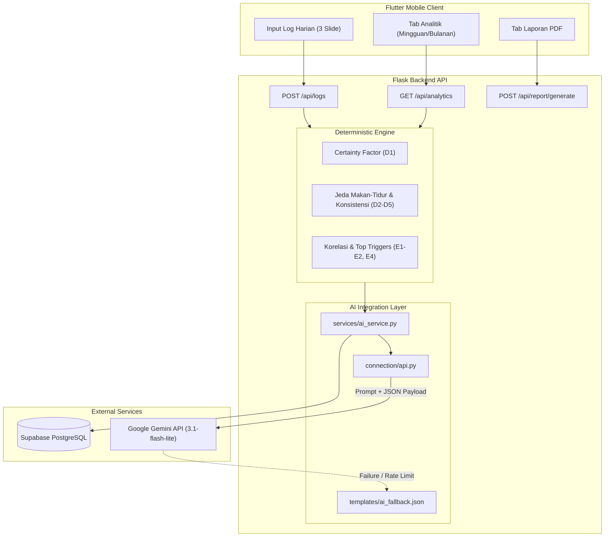
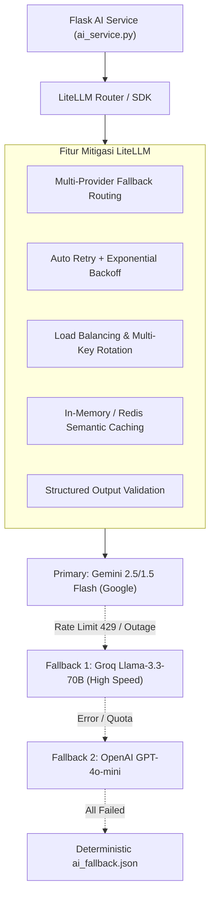

# Rencana Implementasi: Analisis Project GERDHero, Risiko Kegagalan AI, dan Mitigasi dengan LiteLLM

## Analisis Arsitektur & Peran AI dalam GERDHero

Project **GERDHero** (`git-hero-backend`) adalah backend berbasis **Python Flask** yang melayani aplikasi mobile Flutter untuk pemantauan mandiri penderita GERD (*Gastroesophageal Reflux Disease*) di Indonesia. Sistem ini berkolaborasi dengan **Supabase PostgreSQL & Auth** untuk persistensi data dan **Google Gemini API** (`gemini-3.1-flash-lite`) untuk pemrosesan penalaran bahasa alami.

### Filosofi Desain: Pemisahan Deterministik vs AI Generatif
Salah satu kekuatan utama arsitektur GERDHero adalah prinsip **Medical Boundary Separation**:
1. **Komputasi Medis & Statistik Bersifat Deterministik:**
   - Skor Level GERD Harian dihitung menggunakan algoritma *Certainty Factor* (CF) pada [`proses_gejala.py`](file:///C:/Users/acer/Documents/hackaton/git-hero-backend/backend/services/proses_gejala.py) dengan bobot klinis tetap (misal: Regurgitasi 0.7, Nyeri dada 0.8, Heartburn 0.6).
   - Konsistensi pola makan, jeda makan-tidur (patokan ≥ 2 jam), dan flag iritan dihitung secara deterministik pada [`proses_harian.py`](file:///C:/Users/acer/Documents/hackaton/git-hero-backend/backend/services/proses_harian.py).
   - Analitik tren dan korelasi faktor penaik/penurun dihitung dengan formula matematika pada [`analytics_service.py`](file:///C:/Users/acer/Documents/hackaton/git-hero-backend/backend/services/analytics_service.py).
2. **AI Murni Berperan sebagai Natural Language Generation (NLG) & Contextual Reasoning:**
   - Model AI **tidak pernah dibiarkan melakukan diagnosis** atau menghitung statistik mentah.
   - AI hanya menerima data terstruktur yang telah divalidasi dan mengubahnya menjadi narasi empatik, penjelasan korelasi dengan kata "berpotensi berkaitan", serta saran kebiasaan praktis.



---

## Fitur-Fitur yang Melibatkan AI

Berdasarkan telaah kode pada [`ai_service.py`](file:///C:/Users/acer/Documents/hackaton/git-hero-backend/backend/services/ai_service.py), [`routes/logs.py`](file:///C:/Users/acer/Documents/hackaton/git-hero-backend/backend/routes/logs.py), dan [`routes/analytics.py`](file:///C:/Users/acer/Documents/hackaton/git-hero-backend/backend/routes/analytics.py), terdapat **3 fitur utama** yang mengandalkan AI:

### 1. Fitur C5 / D6: Analisis Harian Log (Daily Log Insight)
- **Fungsi Backend:** [`generate_daily_analysis(log_data)`](file:///C:/Users/acer/Documents/hackaton/git-hero-backend/backend/services/ai_service.py#L56-L71)
- **Endpoint Terkait:** `POST /api/logs`
- **Tujuan:** Memberikan umpan balik instan pada **Slide 3 Log Harian** setelah pengguna mengisi gejala, pemicu makanan/minuman, jam makan, jam tidur, tingkat stres, dan konsumsi obat.
- **Input Konteks ke AI:**
  - `symptoms`: Gejala yang dialami hari ini.
  - `triggers`: Flag 5 iritan (pedas, gorengan, asam, kafein, soda).
  - `indicators`: Hasil kalkulasi deterministik konsistensi jam makan, frekuensi makan, jeda makan-tidur.
  - `stress_level` & `sleep_duration_minutes`.
- **Output AI yang Diharapkan:**
  - `analisis_pemicu_gejala`: Array object berisi pemicu yang dicurigai dan penjelasan korelasi empatik.
  - `ringkasan_analisis`: Penjelasan singkat kondisi lambung hari ini tanpa mendiagnosis.
  - `rekomendasi`: 1–3 saran praktis untuk pemulihan hari berikutnya.

### 2. Fitur E3 / D6: Ringkasan Analitik Periode (Period Analytics Summary)
- **Fungsi Backend:** [`generate_analytics_summary(period_data)`](file:///C:/Users/acer/Documents/hackaton/git-hero-backend/backend/services/ai_service.py#L73-L88)
- **Endpoint Terkait:** `GET /api/analytics?period=weekly|monthly|custom`
- **Tujuan:** Menghasilkan narasi kontekstual ringkas pada kartu analitik untuk menerangkan tren fluktuasi level GERD selama 7 hari atau 30 hari terakhir.
- **Input Konteks ke AI:**
  - Data tren level GERD harian (tanggal & skor CF).
  - Pemicu teratas (*top triggers*) pada hari-hari bergejala.
  - Faktor penambah dan pengurang level GERD (selisih rata-rata).
- **Output AI yang Diharapkan:**
  - Teks narasi maksimal 3 kalimat dalam Bahasa Indonesia yang merangkum dinamika kesehatan lambung pengguna secara empatik dan objektif.

### 3. Fitur E5 / D6: Rekomendasi Kebiasaan Jangka Panjang (Habit Recommendations)
- **Fungsi Backend:** [`generate_habit_recommendations(context)`](file:///C:/Users/acer/Documents/hackaton/git-hero-backend/backend/services/ai_service.py#L90-L107)
- **Endpoint Terkait:** `GET /api/analytics`
- **Tujuan:** Memberikan rekomendasi gaya hidup yang dipersonalisasi berdasarkan riwayat catatan dan profil pengguna.
- **Input Konteks ke AI:**
  - Data demografi/profil: `nickname`, `bmi`, riwayat merokok/alkohol/kopi.
  - Data agregat: Rata-rata level GERD, frekuensi pemicu, jeda makan-tidur, dan durasi tidur.
- **Output AI yang Diharapkan:**
  - Array string berisi 3–5 rekomendasi kebiasaan harian (misal: penyesuaian jam santap malam, manajemen stres, atau substitusi minuman).

---

## Risiko Kegagalan Response AI pada Kondisi Saat Ini

Implementasi saat ini pada [`connection/api.py`](file:///C:/Users/acer/Documents/hackaton/git-hero-backend/backend/connection/api.py) dan [`ai_service.py`](file:///C:/Users/acer/Documents/hackaton/git-hero-backend/backend/services/ai_service.py) memiliki beberapa kerentanan arsitektural:

```python
# Implementasi saat ini (connection/api.py)
def generate_text(prompt: str) -> str:
    response = _get_client().models.generate_content(
        model="gemini-3.1-flash-lite",
        contents=prompt,
    )
    return response.text
```

| Kategori Risiko | Deskripsi Dampak pada GERDHero | Tingkat Risiko |
| :--- | :--- | :---: |
| **1. Rate Limiting (HTTP 429)** | Gemini API Free Tier dibatasi 15 Request Per Minute (RPM) dan 1.500 Request Per Day. Saat demo atau pengujian serentak, request akan langsung di-reject dengan pesan *ResourceExhausted*. | **Kritis (High)** |
| **2. Single Point of Failure (SPOF)** | Ketergantungan 100% pada satu model/provider (`gemini-3.1-flash-lite`). Jika server Google mengalami downtime, degradasi regional, atau *maintenance*, seluruh fitur AI lumpuh. | **Kritis (High)** |
| **3. Latency Spikes & Timeout** | LLM dapat mengalami lonjakan latensi (3–10 detik). Pada aplikasi mobile, hal ini memicu request timeout di client, menyebabkan form log terasa *hang* atau lambat. | **Tinggi (Medium-High)** |
| **4. JSON Schema Inconsistency** | LLM sering menambahkan teks pembuka, markdown fence yang tidak standar, atau melupakan key JSON wajib (`analisis_pemicu_gejala`). Parser [`_parse_json_response`](file:///C:/Users/acer/Documents/hackaton/git-hero-backend/backend/services/ai_service.py#L25-L39) akan melempar `ValueError`/`json.JSONDecodeError`. | **Tinggi (Medium-High)** |
| **5. Model Deprecation / Drift** | String model di-hardcode `"gemini-3.1-flash-lite"`. Jika Google memperbarui versi model atau mengubah endpoint di SDK `google-genai`, integrasi akan patah tanpa peringatan dini. | **Sedang (Medium)** |
| **6. Keterbatasan Fallback Statis** | Solusi fallback saat ini ([`ai_fallback.json`](file:///C:/Users/acer/Documents/hackaton/git-hero-backend/backend/templates/ai_fallback.json)) hanya memuat 1 varian teks statis ("Layanan analisis sedang tidak tersedia..."). Jika AI sering mati, pengguna mendapatkan teks yang berulang-ulang, merusak UX aplikasi kesehatan. | **Sedang (Medium)** |

---

## Solusi LiteLLM sebagai Mitigasi Komprehensif

**LiteLLM** adalah universal proxy & SDK abstraction layer yang menstandarisasi panggilan ke lebih dari 100+ model LLM (Gemini, OpenAI, Anthropic, Groq/Llama, DeepSeek, Ollama, dll.) dengan antarmuka seragam (OpenAI format).

Berikut adalah pemetaan bagaimana LiteLLM memitigasi seluruh risiko di atas:



### 1. Multi-Provider Fallbacks (Zero Downtime)
- Jika provider utama (Google Gemini) mengembalikan HTTP 429 (Rate Limit) atau HTTP 500/503 (Downtime), LiteLLM secara otomatis dan instan memindahkan request ke provider cadangan (misal: Groq Llama-3.3 atau OpenAI GPT-4o-mini) dalam rentang milidetik tanpa interupsi bagi pengguna frontend.

### 2. Automatic Retries & Exponential Backoff
- Untuk gangguan jaringan sementara (*transient connection resets*), LiteLLM memiliki konfigurasi `num_retries=2` atau `3` dengan delay backoff dinamis sehingga request tidak langsung gagal pada percobaan pertama.

### 3. Load Balancing & Multiple API Keys
- LiteLLM mendukung *round-robin* atau *least-busy* load balancing antar beberapa API key untuk satu provider. Tim dapat mendaftarkan 2–3 free tier key untuk melipatgandakan batas 15 RPM menjadi 45 RPM.

### 4. Response Caching (Hemat Kuota & Kecepatan Tinggi)
- Fitur caching bawaan LiteLLM dapat menyimpan jawaban AI untuk konteks atau kombinasi gejala yang sama persis (misal kombinasi 5 iritan standar).
- Endpoint analitik mingguan dapat langsung merespons dalam < 50ms dari cache tanpa memanggil API eksternal sama sekali.

### 5. Enforced Structured Output (Anti-Malformed JSON)
- LiteLLM mendukung parameter `response_format={"type": "json_object"}` secara native di berbagai backend LLM, memastikan output selalu berupa JSON valid dan tidak terselubung format markdown liar.

### 6. Unified Architecture & Observability
- Mengeliminasi ketergantungan erat pada library vendor (`google-genai`). Seluruh pemanggilan menggunakan satu sintaks standar: `completion(model=..., messages=...)`.
- LiteLLM juga menyediakan logging latensi dan estimasi biaya per request, sangat penting untuk monitoring performa sistem.

---

## User Review Required

> [!IMPORTANT]
> **Pilihan Provider LLM Cadangan (Fallback Models):**
> Untuk mengaktifkan failover otomatis di LiteLLM, sistem memerlukan minimal 1 provider alternatif di samping Google Gemini. Pilihan paling hemat & cepat:
> 1. **Groq Cloud (Llama-3.3-70B-Versatile):** Free tier sangat cepat (~500 token/detik), sangat cocok untuk fallback instan.
> 2. **OpenAI (GPT-4o-mini):** Sangat murah (~$0.15/1M token) dan kepatuhan JSON sangat tinggi.
> 3. **Rotasi Multi-Key Gemini:** Tetap menggunakan Google Gemini, namun mendistribusikan beban ke 2-3 API key berbeda untuk menghindari limit 15 RPM.

> [!WARNING]
> **Metode Integrasi LiteLLM:**
> - **Opsi A (Direct Python SDK - Direkomendasikan untuk Backend Flask):** Menggunakan package `litellm` langsung di dalam kode Python backend. Ringan, tanpa perlu infrastruktur docker tambahan.
> - **Opsi B (LiteLLM Proxy Server Standalone):** Menjalankan LiteLLM sebagai microservice proxy terpisah (Docker). Lebih cocok untuk skala enterprise besar, namun berlebihan untuk skala hackathon/MVP saat ini.

---

## Open Questions

1. **Prioritas Fallback Provider:** Apakah tim sudah memiliki API key alternatif (misal Groq atau OpenAI), atau untuk saat ini difokuskan pada rotasi multi-key Gemini + skema fallback bertingkat?
2. **Strategi Caching:** Apakah caching respon analitik di memori Python (in-memory cache) sudah mencukupi, atau diperlukan redis/database storage untuk persistensi antar restart server?

---

## Proposed Changes

Rencana refactoring bertahap untuk menerapkan mitigasi LiteLLM pada backend:

### Component: Dependencies & Konfigurasi

#### [MODIFY] [`requirements.txt`](file:///C:/Users/acer/Documents/hackaton/git-hero-backend/backend/requirements.txt)
- Menambahkan dependensi `litellm`
- Menjadikan `google-genai` opsional atau sekunder karena LiteLLM sudah menangani konektor Gemini secara native.

```diff
--- a/backend/requirements.txt
+++ b/backend/requirements.txt
@@ -1,8 +1,9 @@
 Flask>=3.0,<4.0
 supabase
 python-dotenv
-google-genai
+litellm>=1.40.0
 requests
 flask-cors
 reportlab>=4.0      # PDF generation (F2)
 # ATAU: fpdf2>=2.7  # alternatif lebih ringan
```

#### [MODIFY] [`config.py`](file:///C:/Users/acer/Documents/hackaton/git-hero-backend/backend/config.py)
- Menambahkan parameter model list, optional secondary API keys (`GROQ_API_KEY` / `OPENAI_API_KEY`), dan konfigurasi retry/timeout.

```diff
--- a/backend/config.py
+++ b/backend/config.py
@@ -17,6 +17,8 @@
     flask_secret_key: str
     flask_debug: bool
     gemini_api_key: str
+    groq_api_key: str | None
+    primary_ai_model: str
     supabase_url: str
     supabase_publishable_key: str
     supabase_secret_key: str
@@ -68,6 +70,8 @@
         flask_secret_key=getenv("FLASK_SECRET_KEY", ""),
         flask_debug=_parse_bool(getenv("FLASK_DEBUG")),
         gemini_api_key=getenv("GEMINI_API_KEY", ""),
+        groq_api_key=getenv("GROQ_API_KEY"),
+        primary_ai_model=getenv("PRIMARY_AI_MODEL", "gemini/gemini-2.5-flash"),
         supabase_url=supabase_url,
         supabase_publishable_key=getenv("SUPABASE_PUBLISHABLE_KEY", ""),
         supabase_secret_key=getenv("SUPABASE_SECRET_KEY", ""),
```

---

### Component: AI Gateway & Abstraction Layer

#### [MODIFY] [`connection/api.py`](file:///C:/Users/acer/Documents/hackaton/git-hero-backend/backend/connection/api.py)
- Mengganti pemanggilan langsung Google GenAI dengan `litellm.completion` atau `litellm.Router`.
- Menambahkan konfigurasi fallback model list dan timeout terukur.

```python
# Desain baru connection/api.py menggunakan LiteLLM
import os
from litellm import completion, Router
from config import get_settings

def _init_router() -> Router:
    settings = get_settings()
    model_list = [
        {
            "model_name": "primary-model",
            "litellm_params": {
                "model": settings.primary_ai_model,
                "api_key": settings.gemini_api_key,
                "timeout": 8,
            },
        },
    ]
    if settings.groq_api_key:
        model_list.append({
            "model_name": "primary-model",
            "litellm_params": {
                "model": "groq/llama-3.3-70b-versatile",
                "api_key": settings.groq_api_key,
                "timeout": 5,
            },
        })
    return Router(
        model_list=model_list,
        fallbacks=[{"primary-model": ["primary-model"]}],
        num_retries=2,
    )

def generate_text(prompt: str, json_mode: bool = False) -> str:
    settings = get_settings()
    kwargs = {"response_format": {"type": "json_object"}} if json_mode else {}
    
    response = completion(
        model=settings.primary_ai_model,
        messages=[{"role": "user", "content": prompt}],
        api_key=settings.gemini_api_key,
        fallbacks=["groq/llama-3.3-70b-versatile"] if settings.groq_api_key else None,
        num_retries=2,
        timeout=8,
        **kwargs
    )
    return response.choices[0].message.content
```

---

### Component: AI Service Resilience & Normalization

#### [MODIFY] [`services/ai_service.py`](file:///C:/Users/acer/Documents/hackaton/git-hero-backend/backend/services/ai_service.py)
- Memanfaatkan parameter `json_mode=True` pada `generate_text`.
- Memperkuat ketahanan validasi skema keluaran JSON.
- Mempertahankan [`ai_fallback.json`](file:///C:/Users/acer/Documents/hackaton/git-hero-backend/backend/templates/ai_fallback.json) sebagai lapisan pertahanan terakhir (*last line of defense*) jika seluruh provider internet/AI tidak dapat dijangkau.

---

## Verification Plan

### Automated Tests
1. **Unit Test LiteLLM Fallback Simulation:**
   - Membuat test script `backend/tests/test_ai_resilience.py`.
   - Menguji skenario:
     - Primary model mengembalikan HTTP 429 $\rightarrow$ LiteLLM berhasil mengalihkan ke model cadangan secara transparan.
     - Seluruh LLM offline $\rightarrow$ Service dengan aman mengembalikan struktur dari `templates/ai_fallback.json` tanpa *crash* 500.
2. **Validasi Kontrak JSON:**
   - Memastikan ketiga fungsi (`generate_daily_analysis`, `generate_analytics_summary`, `generate_habit_recommendations`) selalu mengembalikan tipe data yang sesuai kontrak antarmuka frontend.

### Manual Verification
1. **Simulasi Invalid API Key:**
   - Ubah `GEMINI_API_KEY` menjadi nilai dummy di `.env`.
   - Lakukan request `POST /api/logs` dari Postman atau script curl.
   - Verifikasi apakah failover ke model sekunder berhasil, atau fallback template aktif dengan respons HTTP 200/success (bukan 500 error).
2. **Simulasi Load / Rate Limit:**
   - Eksekusi 20 request beruntun ke `POST /api/logs` dalam waktu 5 detik.
   - Verifikasi tidak ada request yang gagal dengan status *Unhandled Exception*.
