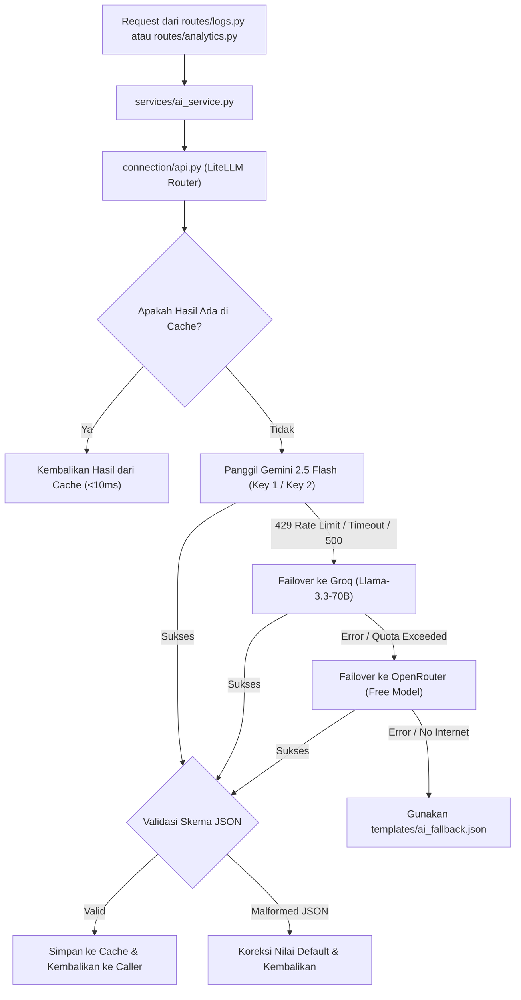

# Implementation Plan: Integrasi LiteLLM & Resilient Multi-Provider Fallback

Dokumen ini merupakan panduan implementasi teknis (*Implementation Plan*) untuk mengintegrasikan **LiteLLM** ke dalam backend **GERDHero** (`git-hero-backend`). Rencana ini bertujuan memitigasi risiko kegagalan respons AI (*rate limits*, *downtime*, format JSON inkonsisten) melalui arsitektur multi-model dan multi-provider gratis (*free tier*).

---

## 1. Jawaban Teknis: Multi-Model & Multi-Key Gemini di LiteLLM

> **Pertanyaan Pengguna:**  
> *"Kalau gemini-genaiku pakai beberapa model tapi dengan api keys apakah bisa dimasukkan ke fallback model di litellm?"*

### Jawaban: SANGAT BISA!
LiteLLM memiliki modul `Router` bawaan yang dirancang khusus untuk skenario ini. Anda dapat mengonfigurasi:
1. **Multi-Model dengan Satu atau Beberapa API Keys:**
   - Misalnya: Model utama memakai `gemini/gemini-2.5-flash` dengan `GEMINI_API_KEY_1`.
   - Jika terkena limit kuota/error, LiteLLM otomatis turun (*failover*) ke `gemini/gemini-1.5-flash` atau `gemini/gemini-1.5-flash-8b`.
2. **Multi-Key Load Balancing & Key-Level Failover:**
   - Anda dapat mendaftarkan beberapa akun/API key Google Gemini untuk model yang sama.
   - LiteLLM Router dapat melakukan rotasi *round-robin* atau memindahkan request ke `GEMINI_API_KEY_2` secara instan ketika `GEMINI_API_KEY_1` mengembalikan HTTP 429 (*Rate Limit*).

#### Contoh Konfigurasi Router Multi-Key & Multi-Model di LiteLLM:
```python
from litellm import Router

model_list = [
    # Deployment 1: Gemini 2.5 Flash dengan Key 1
    {
        "model_name": "primary-gemini",
        "litellm_params": {
            "model": "gemini/gemini-2.5-flash",
            "api_key": os.getenv("GEMINI_API_KEY_1"),
            "rpm": 15,
        },
    },
    # Deployment 2: Gemini 2.5 Flash dengan Key 2 (Menambah kapasitas kuota)
    {
        "model_name": "primary-gemini",
        "litellm_params": {
            "model": "gemini/gemini-2.5-flash",
            "api_key": os.getenv("GEMINI_API_KEY_2"),
            "rpm": 15,
        },
    },
    # Deployment 3: Gemini 1.5 Flash (Model lebih ringan sebagai fallback internal Google)
    {
        "model_name": "fallback-gemini-lighter",
        "litellm_params": {
            "model": "gemini/gemini-1.5-flash-8b",
            "api_key": os.getenv("GEMINI_API_KEY_1"),
        },
    },
    # Deployment 4: Groq Cloud (Cross-provider fallback di luar ekosistem Google)
    {
        "model_name": "fallback-groq",
        "litellm_params": {
            "model": "groq/llama-3.3-70b-versatile",
            "api_key": os.getenv("GROQ_API_KEY"),
        },
    },
]

router = Router(
    model_list=model_list,
    routing_strategy="usage-based-routing",  # Menyeimbangkan pemakaian kuota
    fallbacks=[
        {"primary-gemini": ["fallback-gemini-lighter", "fallback-groq"]}
    ],
    allowed_fails=1,
    cooldown_time=60, # Tunggu 60 detik sebelum mencoba kembali key yang limit
)
```

---

## 2. Daftar Provider API LLM dengan Free Tier (Tanpa Kartu Kredit)

Karena OpenAI API tidak menyediakan tier gratis (membutuhkan deposit saldo prabayar), berikut adalah daftar penyedia API LLM yang menyediakan **Free Tier berbiaya nol** dan didukung langsung oleh LiteLLM untuk dijadikan *fallback list*:

| Provider | Model yang Direkomendasikan | Karakteristik Free Tier | Format Model LiteLLM | Cara Mendapatkan Key |
| :--- | :--- | :--- | :--- | :--- |
| **1. Google AI Studio** *(Primary)* | `gemini-2.5-flash`<br>`gemini-1.5-flash`<br>`gemini-1.5-flash-8b` | • **15 RPM**, 1.500 RPD, 1M TPM<br>• Gratis tanpa kartu kredit<br>• Konteks window besar | `gemini/gemini-2.5-flash`<br>`gemini/gemini-1.5-flash` | [aistudio.google.com](https://aistudio.google.com/) |
| **2. Groq Cloud** *(Fallback #1 - Dikonfirmasi)* | `llama-3.3-70b-versatile`<br>`llama-3.1-8b-instant`<br>`mixtral-8x7b-32768` | • Kecepatan ekstrem (~300–700 tps)<br>• **30 RPM**, 1.000–14.400 RPD<br>• Gratis tanpa kartu kredit<br>• Format output JSON sangat stabil | `groq/llama-3.3-70b-versatile`<br>`groq/llama-3.1-8b-instant` | [console.groq.com](https://console.groq.com/) |
| **3. OpenRouter** *(Fallback #2 - Sangat Fleksibel)* | Model berakhiran `:free`:<br>• `meta-llama/llama-3.3-70b-instruct:free`<br>• `google/gemini-2.0-flash-lite:free`<br>• `qwen/qwen-2.5-72b-instruct:free`<br>• `deepseek/deepseek-r1:free` | • 1 API Key untuk akses ke puluhan model gratis komunitas<br>• Rate limit: 20 request/menit, 200 request/hari<br>• Sangat cocok sebagai "jaring pengaman" terakhir | `openrouter/meta-llama/llama-3.3-70b-instruct:free`<br>`openrouter/google/gemini-2.0-flash-lite:free` | [openrouter.ai](https://openrouter.ai/) |
| **4. Cerebras Cloud** *(Fallback #3)* | `llama3.1-8b`<br>`llama3.1-70b` | • Kecepatan super tinggi (>1.200 tps)<br>• Free Tier: 30 RPM, 1.000.000 token/hari<br>• Sangat responsif untuk form log mobile | `cerebras/llama3.1-70b` | [cloud.cerebras.ai](https://cloud.cerebras.ai/) |
| **5. GitHub Models (Azure)** | `gpt-4o-mini`<br>`meta-llama-3.1-70b`<br>`Phi-3.5-mini-instruct` | • Gratis untuk semua pemilik akun GitHub<br>• Model OpenAI (GPT-4o mini) bisa diakses gratis di sini!<br>• Limit prototyping: 15 RPM, 150 RPD | `github/gpt-4o-mini` | [github.com/marketplace/models](https://github.com/marketplace/models) |
| **6. Mistral AI (La Plateforme)** | `mistral-small-latest`<br>`open-mistral-7b` | • Menyediakan tier eksperimen gratis saat registrasi<br>• Kualitas penalaran tinggi berbahasa non-Inggris | `mistral/mistral-small-latest` | [console.mistral.ai](https://console.mistral.ai/) |

> [!TIP]
> **Rekomendasi Rantai Fallback Terbaik untuk GERDHero:**
> 1. **Primary Tier:** `gemini/gemini-2.5-flash` (Google AI Studio Key 1 & Key 2)
> 2. **Fallback Tier 1:** `groq/llama-3.3-70b-versatile` (Super cepat, format JSON presisi)
> 3. **Fallback Tier 2:** `openrouter/meta-llama/llama-3.3-70b-instruct:free` (Jaring pengaman lintas provider)
> 4. **Emergency Tier:** Template deterministik lokal di [`templates/ai_fallback.json`](file:///C:/Users/acer/Documents/hackaton/git-hero-backend/backend/templates/ai_fallback.json).

---

## 3. Arsitektur Target Integrasi LiteLLM

Berikut adalah diagram alur keputusan (*decision flow*) failover otomatis yang akan diimplementasikan:



---

## 4. User Review Required

> [!IMPORTANT]
> **1. Penambahan Variabel Lingkungan (.env):**
> Integrasi ini membutuhkan penambahan variabel konfigurasi baru pada `.env`:
> - `GEMINI_API_KEY_2` *(Opsional)*: API key kedua Gemini jika ingin multi-key rotasi.
> - `GROQ_API_KEY`: API key dari Groq Console (gratis).
> - `OPENROUTER_API_KEY` *(Opsional)*: API key dari OpenRouter jika ingin cadangan tier 2.
>
> **2. Dependensi Python:**
> Menambahkan `litellm>=1.40.0` ke dalam [`requirements.txt`](file:///C:/Users/acer/Documents/hackaton/git-hero-backend/backend/requirements.txt). Paket ini murni berbasis Python dan tidak memerlukan Docker atau Redis untuk in-memory fallback routing.

---

## 5. Proposed Changes (Rincian Perubahan File)

### Component: Konfigurasi & Dependensi

#### [MODIFY] [`requirements.txt`](file:///C:/Users/acer/Documents/hackaton/git-hero-backend/backend/requirements.txt)
Menambahkan `litellm` sebagai gateway LLM seragam:
```diff
--- a/backend/requirements.txt
+++ b/backend/requirements.txt
@@ -1,8 +1,9 @@
 Flask>=3.0,<4.0
 supabase
 python-dotenv
-google-genai
+litellm>=1.40.0
 requests
 flask-cors
 reportlab>=4.0      # PDF generation (F2)
 # ATAU: fpdf2>=2.7  # alternatif lebih ringan
```

#### [MODIFY] [`config.py`](file:///C:/Users/acer/Documents/hackaton/git-hero-backend/backend/config.py)
Menambahkan pengaturan API key sekunder dan konfigurasi model:
```diff
--- a/backend/config.py
+++ b/backend/config.py
@@ -17,6 +17,10 @@
     flask_secret_key: str
     flask_debug: bool
     gemini_api_key: str
+    gemini_api_key_2: str | None
+    groq_api_key: str | None
+    openrouter_api_key: str | None
+    primary_ai_model: str
     supabase_url: str
     supabase_publishable_key: str
     supabase_secret_key: str
@@ -68,6 +72,10 @@
         flask_secret_key=getenv("FLASK_SECRET_KEY", ""),
         flask_debug=_parse_bool(getenv("FLASK_DEBUG")),
         gemini_api_key=getenv("GEMINI_API_KEY", ""),
+        gemini_api_key_2=getenv("GEMINI_API_KEY_2"),
+        groq_api_key=getenv("GROQ_API_KEY"),
+        openrouter_api_key=getenv("OPENROUTER_API_KEY"),
+        primary_ai_model=getenv("PRIMARY_AI_MODEL", "gemini/gemini-2.5-flash"),
         supabase_url=supabase_url,
         supabase_publishable_key=getenv("SUPABASE_PUBLISHABLE_KEY", ""),
         supabase_secret_key=getenv("SUPABASE_SECRET_KEY", ""),
```

---

### Component: AI Gateway ([`connection/api.py`](file:///C:/Users/acer/Documents/hackaton/git-hero-backend/backend/connection/api.py))

#### [MODIFY] [`connection/api.py`](file:///C:/Users/acer/Documents/hackaton/git-hero-backend/backend/connection/api.py)
Mengganti client tunggal `genai.Client` dengan `litellm.Router` yang mendukung multi-key Gemini, Groq, dan OpenRouter:

```python
"""LiteLLM-backed resilient AI Gateway with multi-provider fallbacks."""

from __future__ import annotations

import logging
from typing import Any
import litellm
from litellm import Router

from config import get_settings

logger = logging.getLogger(__name__)

# Nonaktifkan telemetri dan log berlebih pada production
litellm.telemetry = False


def _build_model_list() -> list[dict[str, Any]]:
    settings = get_settings()
    deployments: list[dict[str, Any]] = []

    # 1. Primary Model: Gemini Flash (Key 1)
    if settings.gemini_api_key:
        deployments.append({
            "model_name": "gerdhero-primary",
            "litellm_params": {
                "model": settings.primary_ai_model,
                "api_key": settings.gemini_api_key,
                "timeout": 7,
            },
        })

    # 2. Primary Model: Gemini Flash (Key 2 jika ada untuk rotasi/load balancing)
    if settings.gemini_api_key_2:
        deployments.append({
            "model_name": "gerdhero-primary",
            "litellm_params": {
                "model": settings.primary_ai_model,
                "api_key": settings.gemini_api_key_2,
                "timeout": 7,
            },
        })

    # 3. Lighter Gemini Model (Internal Google Fallback)
    if settings.gemini_api_key:
        deployments.append({
            "model_name": "gerdhero-gemini-lite",
            "litellm_params": {
                "model": "gemini/gemini-1.5-flash-8b",
                "api_key": settings.gemini_api_key,
                "timeout": 5,
            },
        })

    # 4. Secondary Provider: Groq Cloud (Llama 3.3 70B)
    if settings.groq_api_key:
        deployments.append({
            "model_name": "gerdhero-groq",
            "litellm_params": {
                "model": "groq/llama-3.3-70b-versatile",
                "api_key": settings.groq_api_key,
                "timeout": 5,
            },
        })

    # 5. Tertiary Provider: OpenRouter Free Tier
    if settings.openrouter_api_key:
        deployments.append({
            "model_name": "gerdhero-openrouter",
            "litellm_params": {
                "model": "openrouter/meta-llama/llama-3.3-70b-instruct:free",
                "api_key": settings.openrouter_api_key,
                "timeout": 6,
            },
        })

    return deployments


_router_instance: Router | None = None


def get_router() -> Router:
    global _router_instance
    if _router_instance is None:
        deployments = _build_model_list()
        # Susun daftar fallback berdasarkan provider yang tersedia
        fallback_targets = []
        names = {item["model_name"] for item in deployments}
        for candidate in ["gerdhero-gemini-lite", "gerdhero-groq", "gerdhero-openrouter"]:
            if candidate in names:
                fallback_targets.append(candidate)

        fallbacks = [{"gerdhero-primary": fallback_targets}] if fallback_targets else []

        _router_instance = Router(
            model_list=deployments,
            fallbacks=fallbacks,
            num_retries=2,
            allowed_fails=1,
            cooldown_time=60,
        )
    return _router_instance


def generate_text(prompt: str, json_mode: bool = False) -> str:
    """Generate completion using LiteLLM Router with transparent failover."""
    router = get_router()
    messages = [{"role": "user", "content": prompt}]
    
    kwargs: dict[str, Any] = {
        "model": "gerdhero-primary",
        "messages": messages,
        "temperature": 0.2,
    }
    if json_mode:
        kwargs["response_format"] = {"type": "json_object"}

    response = router.completion(**kwargs)
    choice = response.choices[0]
    return choice.message.content or ""
```

---

### Component: AI Service ([`services/ai_service.py`](file:///C:/Users/acer/Documents/hackaton/git-hero-backend/backend/services/ai_service.py))

#### [MODIFY] [`services/ai_service.py`](file:///C:/Users/acer/Documents/hackaton/git-hero-backend/backend/services/ai_service.py)
Menambahkan flag `json_mode=True` saat memanggil `generate_text`, serta meningkatkan sanitasi JSON parser jika model fallback menyertakan format markdown.

```diff
--- a/backend/services/ai_service.py
+++ b/backend/services/ai_service.py
@@ -67,7 +67,7 @@
     )
 
     try:
-        return _normalise_daily_result(_parse_json_response(generate_text(prompt)))
+        return _normalise_daily_result(_parse_json_response(generate_text(prompt, json_mode=True)))
     except Exception:
         return _load_fallback()
@@ -101,7 +101,7 @@
         f"KONTEKS:\n{json.dumps(context, ensure_ascii=False, default=str)}"
     )
     try:
-        parsed = _parse_json_response(generate_text(prompt))
+        parsed = _parse_json_response(generate_text(prompt, json_mode=True))
         recommendations = parsed.get("rekomendasi")
```

---

### Component: Test Suite & Resilience Verification

#### [NEW] `backend/tests/test_ai_resilience.py`
Membuat test script mandiri untuk memverifikasi:
1. Router berhasil memanggil Gemini ketika sehat.
2. Router otomatis beralih ke Groq saat Gemini disimulasikan gagal (*mock error / 429*).
3. Service tetap mengembalikan struktur JSON fallback yang valid jika seluruh internet/LLM tidak aktif.

---

## 6. Verification Plan

### Automated Verification
Jalankan pengujian menggunakan `pytest` atau script eksekusi Python langsung:
```powershell
# Di direktori backend
python -m pytest tests/test_ai_resilience.py -v
```
**Ekspektasi Hasil:**
- Seluruh skenario fallback lolos (*Pass*):
  - `test_gemini_primary_success`: Mengembalikan respons normal.
  - `test_gemini_failure_fallback_to_groq`: Memverifikasi transisi provider transparan.
  - `test_all_providers_down_returns_fallback_json`: Memverifikasi struktur data tetap utuh sesuai kontrak frontend.

### Manual Verification
1. **Verifikasi Jalur Normal:**
   - Jalankan backend Flask: `python app.py`
   - Kirim `POST /api/logs` dengan payload log harian.
   - Periksa log terminal: memastikan request diproses oleh Gemini.
2. **Verifikasi Failover ke Groq:**
   - Ubah sementara `GEMINI_API_KEY=invalid_dummy_key` di `.env`.
   - Kirim ulang `POST /api/logs`.
   - Periksa log terminal: LiteLLM Router akan mencatat warning pada Gemini dan berhasil mendapatkan jawaban via Groq (`llama-3.3-70b-versatile`). Frontend menerima respon 200 normal!
3. **Verifikasi Emergency Local Fallback:**
   - Matikan koneksi internet atau pasang key invalid pada semua provider.
   - Kirim ulang request.
   - Frontend tetap menerima HTTP 200 dengan payload dari [`ai_fallback.json`](file:///C:/Users/acer/Documents/hackaton/git-hero-backend/backend/templates/ai_fallback.json), tanpa crash 500.
