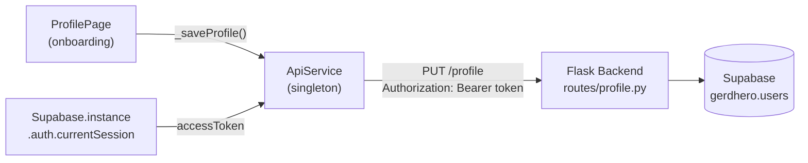

# Integrasi Isi Profile — Frontend ↔ Backend

## Goal Description

`ProfilePage` saat ini langsung navigate ke `GerdQIntroPage` tanpa menyimpan data apapun ke server. Tujuan task ini adalah menghubungkan tombol "Lanjut" di `ProfilePage` ke endpoint `PUT /profile` di Flask backend, sehingga data profil user (nama, tanggal lahir, gender, tinggi, berat) tersimpan ke Supabase sebelum lanjut ke tahap berikutnya.

GERD-Q integration **tidak termasuk** dalam scope ini.

**Backend sudah siap** — `routes/profile.py` mengimplementasikan `PUT /profile` dan `GET /profile` secara penuh. Tidak ada perubahan di sisi backend.

---

## User Review Required

> [!IMPORTANT]
> **Perlu menambah package `http`** ke `pubspec.yaml`. Package ini ringan dan sudah merupakan transitive dependency dari Flutter SDK, hanya perlu di-declare eksplisit.

> [!IMPORTANT]
> **Backend URL dari device fisik** — HP dan laptop harus berada di jaringan WiFi yang sama. URL backend diisi via `.env` menggunakan IP lokal laptop (temukan dengan `ipconfig`).

> [!WARNING]
> **Flask harus dijalankan dengan `--host=0.0.0.0`** agar dapat diakses dari HP. Default `127.0.0.1` tidak bisa dijangkau dari perangkat lain di jaringan.

---

## Proposed Changes

### Arsitektur Data Flow



---

### Layer 1 — HTTP Client

#### [NEW] `lib/core/services/api_service.dart`

Singleton HTTP client yang:
- Membaca `BACKEND_URL` dari `.env` (via `flutter_dotenv`)
- Otomatis menginject `Authorization: Bearer <token>` dari Supabase session aktif
- Melempar `ApiException` yang bisa di-catch di UI layer

```dart
import 'dart:convert';

import 'package:flutter_dotenv/flutter_dotenv.dart';
import 'package:http/http.dart' as http;
import 'package:supabase_flutter/supabase_flutter.dart';

/// Singleton HTTP client untuk komunikasi dengan Flask backend.
///
/// Bearer token diambil otomatis dari Supabase session yang sedang aktif.
/// Gunakan [ApiException] untuk menangani error dari respons backend.
class ApiService {
  ApiService._();
  static final ApiService instance = ApiService._();

  String get _baseUrl => dotenv.env['BACKEND_URL'] ?? 'http://localhost:5000';

  String? get _token =>
      Supabase.instance.client.auth.currentSession?.accessToken;

  Map<String, String> get _headers => {
        'Content-Type': 'application/json',
        if (_token != null) 'Authorization': 'Bearer $_token',
      };

  Future<Map<String, dynamic>> get(String path) async {
    final res = await http.get(
      Uri.parse('$_baseUrl$path'),
      headers: _headers,
    );
    return _parse(res);
  }

  Future<Map<String, dynamic>> put(
    String path,
    Map<String, dynamic> body,
  ) async {
    final res = await http.put(
      Uri.parse('$_baseUrl$path'),
      headers: _headers,
      body: jsonEncode(body),
    );
    return _parse(res);
  }

  Future<Map<String, dynamic>> post(
    String path,
    Map<String, dynamic> body,
  ) async {
    final res = await http.post(
      Uri.parse('$_baseUrl$path'),
      headers: _headers,
      body: jsonEncode(body),
    );
    return _parse(res);
  }

  Map<String, dynamic> _parse(http.Response res) {
    final Map<String, dynamic> decoded;
    try {
      decoded = jsonDecode(res.body) as Map<String, dynamic>;
    } catch (_) {
      throw const ApiException('Respons server tidak valid.', 500);
    }
    if (res.statusCode >= 400) {
      throw ApiException(
        decoded['message'] as String? ?? 'Terjadi kesalahan.',
        res.statusCode,
      );
    }
    return decoded;
  }
}

/// Exception yang dilempar saat backend mengembalikan status code >= 400.
class ApiException implements Exception {
  const ApiException(this.message, this.statusCode);

  final String message;
  final int statusCode;

  @override
  String toString() => 'ApiException($statusCode): $message';
}
```

---

### Layer 2 — Konfigurasi

#### [MODIFY] `mobile_frontend/.env`

Tambah satu baris. Ganti `192.168.x.x` dengan IP lokal laptop (lihat `ipconfig` → IPv4 Address di adapter WiFi):

```diff
+ BACKEND_URL=http://192.168.x.x:5000
```

> [!NOTE]
> HP dan laptop harus terhubung ke WiFi yang **sama**. Jalankan backend dengan: `flask --app app run --host=0.0.0.0 --port=5000`

---

#### [MODIFY] `pubspec.yaml`

Tambah package `http`:

```diff
 dependencies:
   flutter:
     sdk: flutter
   google_fonts: ^6.2.1
   flutter_svg: ^2.0.17
   supabase_flutter: ^2.18.3
   flutter_dotenv: ^6.0.1
+  http: ^1.2.2
```

---

### Layer 3 — Profile Feature

#### [MODIFY] `profile_page.dart`

Tiga perubahan utama:

**1. Tambah import `ApiService`:**
```dart
import '../../../../core/services/api_service.dart';
```

**2. Tambah `_isLoading` state dan method `_saveProfile()`:**

```dart
bool _isLoading = false;

/// Validasi form, simpan ke backend via PUT /profile,
/// lalu navigate ke GerdQIntroPage jika berhasil.
Future<void> _saveProfile() async {
  // Validasi field wajib
  if (_nameController.text.trim().isEmpty) {
    ScaffoldMessenger.of(context).showSnackBar(
      const SnackBar(content: Text('Nama panggilan wajib diisi.')),
    );
    return;
  }
  if (_birthDate == null) {
    ScaffoldMessenger.of(context).showSnackBar(
      const SnackBar(content: Text('Tanggal lahir wajib diisi.')),
    );
    return;
  }

  setState(() => _isLoading = true);
  try {
    final height = double.tryParse(_heightController.text);
    final weight = double.tryParse(_weightController.text);

    await ApiService.instance.put('/profile', {
      'nickname': _nameController.text.trim(),
      'birth_date': _birthDate!.toIso8601String().substring(0, 10), // YYYY-MM-DD
      'gender': _gender == 'Laki-laki' ? 'male' : 'female',
      if (height != null && height > 0) 'height': height,
      if (weight != null && weight > 0) 'weight': weight,
    });

    if (mounted) {
      Navigator.of(context).push(
        MaterialPageRoute<void>(builder: (_) => const GerdQIntroPage()),
      );
    }
  } on ApiException catch (e) {
    if (mounted) {
      ScaffoldMessenger.of(context).showSnackBar(
        SnackBar(content: Text(e.message)),
      );
    }
  } catch (_) {
    if (mounted) {
      ScaffoldMessenger.of(context).showSnackBar(
        const SnackBar(content: Text('Tidak dapat terhubung ke server.')),
      );
    }
  } finally {
    if (mounted) setState(() => _isLoading = false);
  }
}
```

**3. Ubah tombol "Lanjut" — dari hardcoded navigate ke `_saveProfile()`:**

```dart
// SEBELUM
FilledButton(
  onPressed: () => Navigator.of(context).push(
    MaterialPageRoute<void>(builder: (_) => const GerdQIntroPage()),
  ),
  child: const Row(
    mainAxisAlignment: MainAxisAlignment.center,
    children: [
      Text('Lanjut'),
      SizedBox(width: 8),
      Icon(Icons.arrow_forward, size: 18),
    ],
  ),
),

// SESUDAH
FilledButton(
  onPressed: _isLoading ? null : _saveProfile,
  child: _isLoading
      ? const SizedBox(
          width: 20,
          height: 20,
          child: CircularProgressIndicator(
            strokeWidth: 2,
            color: Colors.white,
          ),
        )
      : const Row(
          mainAxisAlignment: MainAxisAlignment.center,
          children: [
            Text('Lanjut'),
            SizedBox(width: 8),
            Icon(Icons.arrow_forward, size: 18),
          ],
        ),
),
```

---

### Kontrak API Backend

**`PUT /profile`** — Tidak ada perubahan di backend.

Request body (semua field opsional kecuali tidak divalidasi backend, validasi ada di frontend):
```json
{
  "nickname": "Andi",
  "birth_date": "1998-05-21",
  "gender": "male",
  "height": 170.0,
  "weight": 65.5
}
```

Response sukses `200`:
```json
{
  "success": true,
  "data": {
    "id": "uuid",
    "nickname": "Andi",
    "birth_date": "1998-05-21",
    "gender": "male",
    "height": 170.0,
    "weight": 65.5,
    "bmi": 22.7,
    "extended": {}
  }
}
```

Response error (misal validasi gagal) `400`:
```json
{
  "success": false,
  "error": "Bad Request",
  "message": "height harus lebih besar dari 0"
}
```

---

## File Summary

| File | Status | Keterangan |
|------|--------|-----------|
| `lib/core/services/api_service.dart` | **[NEW]** | HTTP client singleton |
| `mobile_frontend/.env` | **[MODIFY]** | Tambah `BACKEND_URL=http://192.168.x.x:5000` |
| `pubspec.yaml` | **[MODIFY]** | Tambah `http: ^1.2.2` |
| `lib/features/onboarding/presentation/pages/profile_page.dart` | **[MODIFY]** | `_saveProfile()` + loading state + validasi |
| `backend/routes/profile.py` | ✅ No change | Sudah ready |

---

## Verification Plan

### Automated Tests

```powershell
# 1. Tambah dependency
cd c:\Users\Lenovo\Downloads\GERDHero\gerd-hero\mobile_frontend
flutter pub get

# 2. Cek tidak ada error
flutter analyze lib/

# 3. Test backend dari laptop (ganti TOKEN dengan token Supabase)
curl -X PUT http://localhost:5000/profile `
  -H "Authorization: Bearer TOKEN" `
  -H "Content-Type: application/json" `
  -d '{"nickname":"TestUser","birth_date":"2000-01-01","gender":"male","height":170,"weight":65}'
```

### Manual Verification

1. **Jalankan backend** di laptop:
   ```
   flask --app app run --host=0.0.0.0 --port=5000
   ```
2. **Isi `BACKEND_URL`** di `.env` dengan IP laptop (dari `ipconfig`)
3. **Login Google** di app → pastikan sudah masuk ke `ProfilePage`
4. **Test sukses:** isi semua field → tekan Lanjut
   - Loading spinner muncul sebentar
   - Navigasi ke `GerdQIntroPage`
   - Cek Supabase Table Editor → `gerdhero.users` → row harus terupdate (nickname, birth_date, gender, height, weight, bmi)
5. **Test validasi:** tekan Lanjut tanpa isi nama → SnackBar "Nama panggilan wajib diisi"
6. **Test error network:** matikan backend → tekan Lanjut → SnackBar "Tidak dapat terhubung ke server" (bukan crash)
